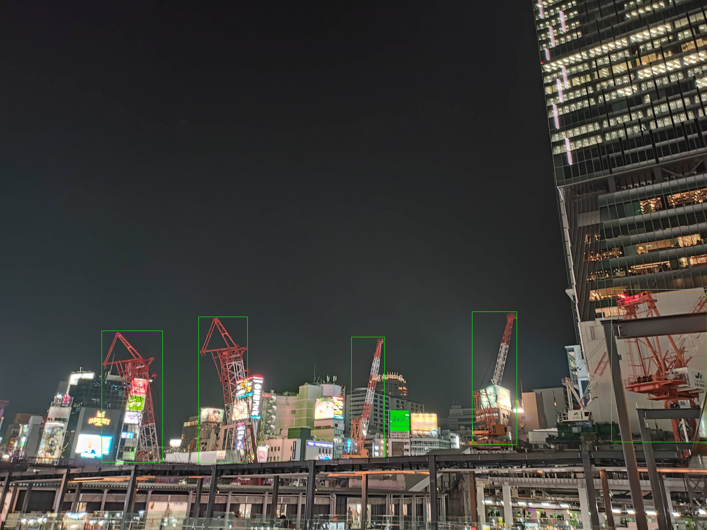

# Object Checker

Object detection tool built with the Google Gemini API, Pydantic, and OpenCV. Given an image and a target object name, the script checks whether the object is present and saves an annotated copy with bounding boxes.

## Demo

Prompt: `"construction crane"`

| Input (`Shibuya.jpg`) | Output (`result4.jpg`) |
| :---: | :---: |
|  |  |

*Note: Five out of six cranes are accurately framed, illustrating typical limitations in low-contrast or cluttered scenes.*

## How It Works

1. **Upload**: Sends the local image to the Gemini Files API (`client.files.upload`).
2. **Structured Inference**: Queries `gemini-flash-lite-latest` via `client.interactions.create` using a Pydantic schema to enforce a strict JSON response (`[[ymin, xmin, ymax, xmax], ...]`).
3. **Post-Processing**: Rescales the normalized coordinates (`0–1000`) to the original image dimensions and draws bounding boxes with OpenCV.

## Setup & Usage

### Prerequisites

* Python 3.10+
* A Google Gemini API key set as an environment variable:

```bash
export GEMINI_API_KEY="your_api_key_here"
